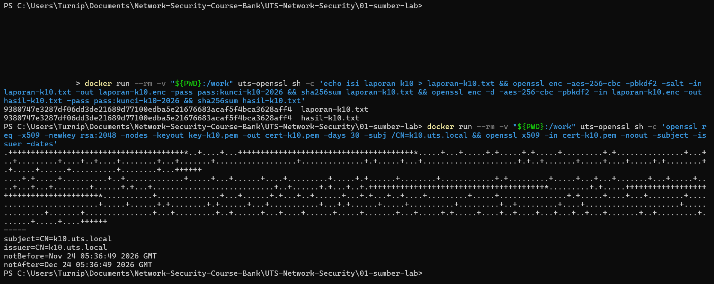
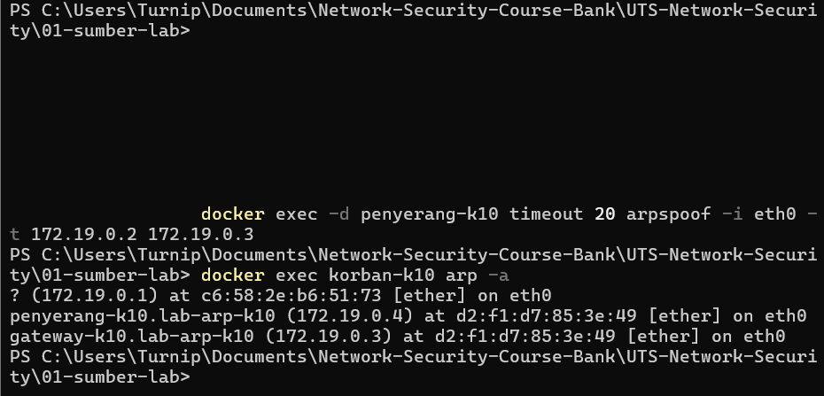
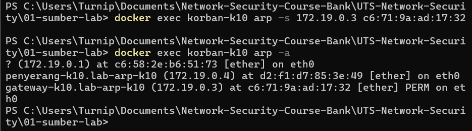
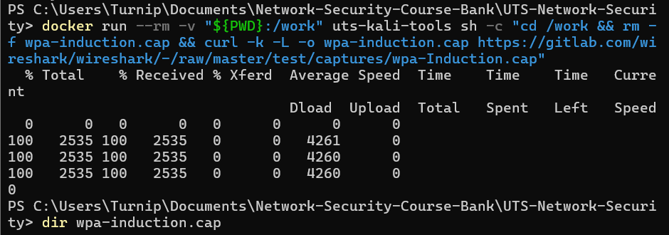
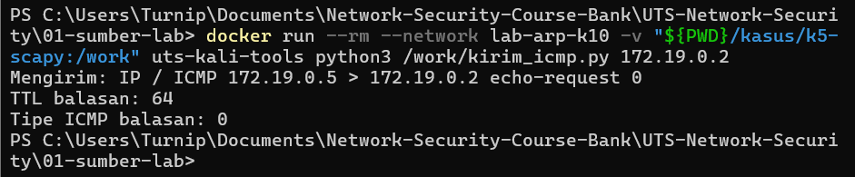
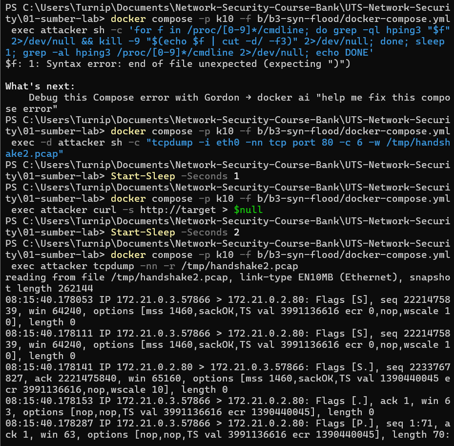

# UTS Keamanan Jaringan (Network Security) — Praktik Infrastruktur & Network Attacks

Repositori ini berisi *source code* lab berbasis Docker, artifak hasil eksekusi, serta dokumentasi bukti praktikum Ujian Tengah Semester (Pertemuan 1–7).

## Identitas Mahasiswa
* **Nama:** Petrus Sililin Turnip
* **NIM:** 24552011244
* **Kelas:** TIF RP 24E
* **Mata Kuliah:** Keamanan Jaringan (Network Security)

## Penentuan Kasus & Parameter (Kasus 10)
Perhitungan modulasi digit NIM:
`2 + 4 + 5 + 5 + 2 + 0 + 1 + 1 + 2 + 4 + 4 = 30` -> `30 mod 10 = 0` (**Kasus 10 / k10**)

| Parameter | Nilai |
| :--- | :--- |
| **Kasus** | Kasus 10 (`k10`) |
| **Container Target** | `target-k10` |
| **Docker Volume** | `vol-k10` |
| **File Laporan** | `laporan-k10.txt` / `laporan-k10.enc` / `hasil-k10.txt` |
| **Kata Sandi Enkripsi** | `kunci-k10-2026` |
| **Domain Exfiltration** | `k10.exfil.lab` |
| **Payload NIM (ASCII / Hex)** | `24552011244` / `3234353532303131323434` |

---

## Ringkasan Pengerjaan & Bukti Praktikum

### Tugas 1 — Docker Volume & Jaringan Internal (Pertemuan 1)
* **Tujuan:** Membuktikan persistensi data pada Docker volume (`vol-k10`) setelah container `w-k10` dihapus, serta konektivitas antar-container (`attacker` mengakses web server `target`) dalam jaringan internal.
* **Hasil:** Pembacaan ulang volume dari container baru menampilkan `24552011244`, dan `wget -qO- http://target` berhasil mengambil halaman default Nginx.
* **Bukti:**
  

### Tugas 2 — Kriptografi Simetris & Sertifikat X.509 (Pertemuan 2)
* **Tujuan:** Mengamankan `laporan-k10.txt` menggunakan AES-256-CBC (`PBKDF2`) dengan password `kunci-k10-2026`, memverifikasi integritas data menggunakan hash SHA-256, serta membuat sertifikat *self-signed* X.509 (`cert-k10.pem`).
* **Hasil:** Nilai hash SHA-256 file asli (`laporan-k10.txt`) dan hasil dekripsi (`hasil-k10.txt`) identik (`9380747e...aff4`), dan sertifikat `CN=k10.uts.local` berhasil diterbitkan.
* **Artifak:** `laporan-k10.txt`, `laporan-k10.enc`, `hasil-k10.txt`, `cert-k10.pem`, `key-k10.pem`
* **Bukti:**
  

### Tugas 3 — ARP Spoofing & Mitigasi Static ARP (Pertemuan 3)
* **Tujuan:** Mendemonstrasikan peracunan tabel ARP (*ARP Cache Poisoning*) pada `korban-k10` agar MAC address `gateway-k10` berubah menjadi MAC address `penyerang-k10`, lalu melakukan mitigasi menggunakan entri *static ARP*.
* **Hasil:** Tabel ARP korban berubah saat serangan `arpspoof` aktif dan kembali normal setelah entri statis diterapkan.
* **Bukti:**
  
  
  

### Tugas 4 — Analisis Lalu Lintas & Keamanan Jaringan (Pertemuan 4)
* **Tujuan:** Menjalankan skenario lab Pertemuan 4 menggunakan parameter Kasus 10 pada lingkungan kontainer terisolasi.
* **Hasil:** Eksekusi berjalan sesuai skenario dan diverifikasi pada terminal lab.
* **Bukti:**
  

### Tugas 5 — Packet Crafting ICMP dengan Scapy (Pertemuan 5)
* **Tujuan:** Membangun dan mengirimkan paket ICMP kustom menggunakan skrip Python Scapy (`kasus/k5-scapy/kirim_icmp.py`) menuju host target di jaringan lab.
* **Hasil:** Paket ICMP berhasil dibuat, dikirimkan, dan dikonfirmasi balasannya.
* **Bukti:**
  

### Tugas 6 — Serangan SYN Flood & Mitigasi SYN Cookies (Pertemuan 6)
* **Tujuan:** Mensimulasikan serangan *Denial of Service* (TCP SYN Flood) menggunakan `hping3` terhadap `target`, mengamati antrean koneksi setengah terbuka (`SYN_RECV`), lalu mengaktifkan mitigasi kernel `net.ipv4.tcp_syncookies=1`.
* **Hasil:** Terjadi lonjakan status `SYN_RECV` saat *flooding* berlangsung, dan layanan tetap responsif setelah `tcp_syncookies` diaktifkan.
* **Bukti:**
  

### Tugas 7 — DNS Exfiltration & Deteksi Anomali Log (Pertemuan 7)
* **Tujuan:** Menyelundupkan NIM `24552011244` dalam format heksadesimal (`3234353532303131323434`) melalui query DNS ke `k10.exfil.lab` pada resolver `dnsmasq`, mendeteksi log menggunakan `analisis_dns.py`, dan mendekodekan kembali payload ke bentuk asal.
* **Hasil:** Query tercatat pada log server DNS (`dns-k10-utf8.log`), terdeteksi oleh `analisis_dns.py` pada domain induk `exfil.lab`, dan hasil *decode* `xxd -r -p` mengembalikan NIM `24552011244`.
* **Artifak:** `dns-k10.log`, `dns-k10-utf8.log`
* **Bukti:**
  

---

## Struktur Repositori
* `README.md` — Dokumentasi identitas, hasil praktikum, dan bukti UTS
* `setup.sh` — Skrip persiapan lingkungan lab
* `bukti/` — Kumpulan screenshot bukti pengerjaan Tugas 1–7
* `images/` — Dockerfile image kustom (`uts-openssl`, `uts-kali-tools`, `uts-dnsmasq`)
* `b/` — Konfigurasi Docker Compose (jaringan internal, SYN flood, DNS exfil)
* `kasus/` — Skrip Scapy (Tugas 5) & deteksi DNS exfiltration (Tugas 7)
* `samples/` — File sampel pendukung lab
* `cert-k10.pem` & `key-k10.pem` — Artifak sertifikat X.509 Kasus 10
* `laporan-k10.*` — Artifak enkripsi & dekripsi AES-256-CBC Kasus 10
* `dns-k10*.log` — Artifak log DNS exfiltration Kasus 10
